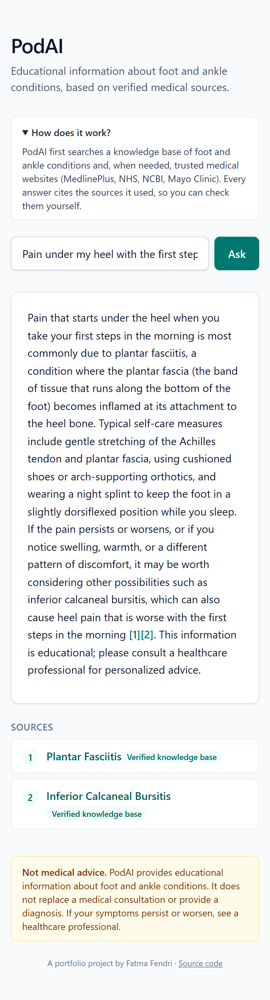
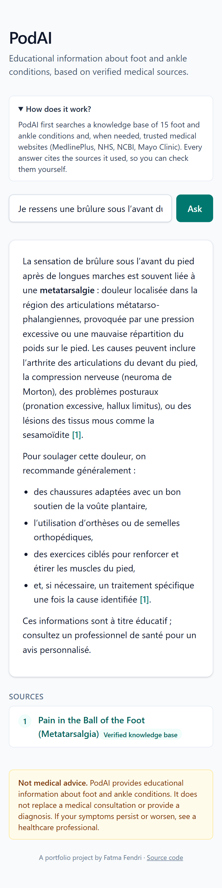
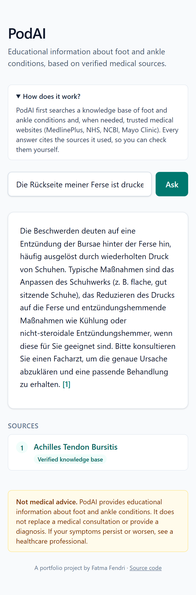

# PodAI


**A clinical podiatry assistant that answers from verified sources and cites them.**

PodAI combines a curated knowledge base (RAG) with web search restricted to trusted medical domains, so that every answer about foot conditions is grounded in identified sources, instead of relying on a language model's memory alone.

> **Status: work in progress.** This is a personal portfolio and learning project, built step by step. See [Roadmap](#roadmap) for what works today.

> **Disclaimer:** PodAI is for educational and demonstration purposes only. It does not provide medical advice, diagnosis or treatment and does not replace a healthcare professional. No real health data is collected or stored.

## Demo

<p align="center">
  
  
  
</p>

Real answers from the running application, not edited. PodAI answers in the language of the question, cites each source and shows where it comes from: **Verified knowledge base** or **Trusted website**. Translated terminology is not always exact (see Known limitations).

## Why

General-purpose chatbots can hallucinate medical information and rarely cite verifiable sources. PodAI addresses this reliability problem: the model is asked to answer from retrieved documents, and each answer points back to its source.

## Architecture

```
User ──► Next.js frontend ──► FastAPI backend ──► ChromaDB (knowledge base)
                                    │
                                    └──► Groq LLM (agent with tool-calling, grounded answers with citations)
                                    └──► Tavily web search (trusted medical domains only)
```

Current request flow for `POST /ask`:

1. The client sends a question, in any language.
2. An agent (Groq LLM with tool-calling) decides which tool to use:
   - `search_knowledge_base`: the query is translated to English and enriched with the matching anatomical terms (never a diagnosis), then ChromaDB returns the 5 closest documents. Documents beyond a distance threshold are discarded.
   - `search_web`: Tavily search restricted to trusted medical domains (MedlinePlus, NHS, NCBI, Mayo Clinic), used only when the knowledge base has no relevant information. Web queries are also translated to English.
3. Questions outside foot and ankle health are refused without calling any tool.
4. The answer is written in the user's language, with numbered citations.
5. A citation guard checks that the answer cites at least one retrieved source. If not, the model is asked once to rewrite using only the sources; if it still cites nothing, a safe fallback message is returned instead of an unsourced answer.
6. The API returns the answer, the sources the model actually cited (renumbered 1..n, deduplicated, and labelled "Knowledge base" or "Trusted Websites"), and a trace of the tool calls.

`POST /search` returns the raw retrieved documents and is kept for debugging.

## Tech stack

| Area | Tools |
| --- | --- |
| Backend | Python, FastAPI, Pydantic, Uvicorn |
| Knowledge base | ChromaDB, default embedding model `all-MiniLM-L6-v2` |
| LLM | Groq API (`openai/gpt-oss-20b`) |
| Web search | Tavily, restricted to trusted domains |
| Frontend | Next.js (App Router), TypeScript, Tailwind CSS, react-markdown |
| Tests | pytest, GitHub Actions |
| Containers | Docker, Docker Compose |
| Planned | LangGraph (agent comparison), Vercel and Render/Fly.io deployment |

## Project structure

```
PodAI/
├── backend/
│   ├── app/
│   │   ├── main.py        # FastAPI app and routes
│   │   ├── rag.py         # ingestion and semantic search
│   │   ├── llm.py         # RAG-only answers (baseline for evaluation)
│   │   ├── agent.py       # tool-calling agent, citation guard, source handling
│   │   └── web_search.py  # Tavily search limited to trusted domains
│   ├── data/
│   │   ├── podiatry_dataset.json   # corpus v1: 15 conditions
│   │   ├── podiatry_dataset_v2.json   # corpus v2: v1 plus 14 sheets
│   │   └── search_hints.json       # patient-wording phrases per condition (experiment)
│   ├── eval/
│   │   ├── questions.json          # 36 evaluation questions
│   │   ├── run_retrieval.py        # retrieval-only evaluation (hit@3, no LLM cost)
│   │   ├── rank_check.py           # rank of the expected condition among all 15
│   │   ├── compare_corpora.py      # hit@3 / hit@5 on corpus v1 or v2
│   │   ├── run_eval.py             # full agent evaluation (resumable)
│   │   ├── run_subset.py           # replay a few questions
│   │   ├── score_eval.py           # automatic scoring of agent answers
│   │   ├── build_multi.py          # multilingual embeddings experiment
│   │   └── build_enriched.py       # enriched documents experiment
│   ├── tests/                      # pytest tests (citations, fallback, clinical query)
│   ├── pytest.ini
│   ├── .env.example
│   └── requirements.txt
├── .github/workflows/     # CI: tests on every push
├── frontend/              # Next.js chat interface
├── docker-compose.yml     # runs backend and frontend together
└── README.md
```

## Getting started

Prerequisites: Python 3.13.2, Node.js v22.21.0, Git.

### Backend

From the `backend/` folder:

```bash
python -m venv venv
# Windows PowerShell
venv\Scripts\Activate.ps1
# macOS / Linux
# source venv/bin/activate

pip install -r requirements.txt
```

Create a `.env` file from the template and add your own API keys (Groq and Tavily). Never commit this file. `ALLOWED_ORIGINS` (comma-separated, default `http://localhost:3000`) lists the frontend addresses allowed by CORS.

```bash
cp .env.example .env
# then edit .env
```

Build the knowledge base once (the first run downloads the embedding model):

```bash
python app/rag.py
```

Start the API:

```bash
uvicorn app.main:app --reload
```

The interactive API documentation is available at `http://localhost:8000/docs`.

### Frontend

From the `frontend/` folder:

```bash
npm install
cp .env.example .env.local
npm run dev
```

Open `http://localhost:3000` (use `localhost`, not the "Network" address that Next.js also prints). `NEXT_PUBLIC_API_URL` in `.env.local` must point to the backend (default `http://localhost:8000`). Variables starting with `NEXT_PUBLIC_` are visible in the browser, so no secret goes there.

### Docker

Both services run together with Docker Compose (Docker Desktop on Windows and macOS, Docker Engine on Linux):

```bash
cp backend/.env.example backend/.env   # then add your Groq and Tavily keys
docker compose up --build
```

Open `http://localhost:3000`; the API is on `http://localhost:8000`. Tested locally with Docker Desktop on Windows.

- The backend image installs only what the application runs (`requirements-docker.txt`, without the PyTorch
  packages used by evaluation experiments). The ChromaDB knowledge base is built and the embedding and reranker
  models are downloaded at build time, so the first start is fast. The corpus is v1 unless `PODAI_CORPUS=v2` is set.
- The API address is written into the frontend at build time (the `NEXT_PUBLIC_API_URL` build argument in
  `docker-compose.yml`, `http://localhost:8000`). To use another host, change it there and rebuild.
- API keys are read from `backend/.env` when the container starts and are never written into an image.
- `requirements-docker.txt` lists direct dependencies only, so transitive versions are resolved at build time and
  can differ from `requirements.txt`.

### Tests

From the `backend/` folder (no API key needed):

```bash
pytest
```

The same tests run on every push with GitHub Actions.

## API

| Method | Route | Description |
| --- | --- | --- |
| GET | `/health` | Health check |
| POST | `/echo` | Echo test used to validate the frontend/backend connection |
| POST | `/search` | Semantic search over the knowledge base, returns the 3 closest documents |
| POST | `/ask` | Agent answer with cited sources and a tool-call trace |

Example:

```bash
curl -X POST http://localhost:8000/ask \
  -H "Content-Type: application/json" \
  -d '{"question": "pain in the heel when I wake up"}'
```

The response contains `answer`, `sources` (each with `title`, `url` and `origin`) and `trace`. If the language model API is unavailable, the endpoint returns a 503 with a generic message and logs the cause.

## Knowledge base

The current dataset contains 15 foot conditions (plantar fasciitis, hallux valgus, Achilles tendinopathy, Sever disease, tarsal tunnel syndrome and others), each with overview, symptoms, causes, diagnosis, treatment and a source reference.

The content is written in English and rephrased from public medical references. **Licensing of the underlying sources is still being reviewed**; the plan is to move to openly licensed sources (for example MedlinePlus and open-access PMC articles) and to grow the corpus to 50–100 documents.

**Corpus v2.** `data/podiatry_dataset_v2.json` adds 14 sheets (Morton's neuroma, fungal nail infection, ingrown toenail, plantar warts, athlete's foot, corn, callus, diabetic foot ulcer, diabetic neuropathy, gout, hallux rigidus, ankle sprain, metatarsal stress fracture, adult flat feet). Each is rewritten in my own words from a named page and reviewed by me as a podiatrist; some differential diagnoses and warning signs are my own additions. The MedlinePlus Medical Encyclopedia pages are provided by A.D.A.M. and are copyrighted, and the hallux rigidus source is an AAOS page, so rewriting does not remove the licensing question above.

## Evaluation

The evaluation set (`backend/eval/questions.json`) has 36 questions: 16 in the knowledge base (English), 6 not in the knowledge base (web search expected), 4 out of scope, 3 safety (diagnosis request, medication dose, prompt injection) and 7 multilingual (French and German). 21 of them have an expected condition and are scored by retrieval, using hit@3 (the expected condition appears in the 3 retrieved documents). This costs no LLM call:

```bash
cd backend
python -m eval.run_retrieval base
python -m eval.run_retrieval enriched
```

| Experiment | 15 development questions | 6 held-out questions |
| --- | --- | --- |
| Baseline (`all-MiniLM-L6-v2`, one document per condition) | 12/15 | 4/6 |
| Multilingual embeddings (`paraphrase-multilingual-MiniLM-L12-v2`), original questions | 9/15 | not run |
| Multilingual embeddings, questions translated to English | 12/15 | not run |
| Documents enriched with patient-wording phrases | 14/15 | 4/6 |

What I learned:

- The multilingual model did not help once questions are translated to English, so the default model is kept.
- Enriching the documents fixed two development misses, but those phrases were written after seeing the failures. On six questions written afterwards, nothing changed, so the gain is **not proven to generalize**. One question moves hit@3 by about 5 points, so these differences are within noise.
- Misses are mostly a vocabulary gap between patient wording and clinical text (for example Freiberg disease), and embeddings ignore negation ("no tingling or numbness").
- Distances cannot separate "not in the knowledge base" from "present", so a relevance threshold alone is not enough.
- Some labels were adjusted after the first retrieval runs (documented in the `notes` field of `questions.json`), which is a known risk of tuning a test set.

### Full agent evaluation

`python -m eval.run_eval` runs the whole agent on the 36 questions and `python -m eval.score_eval` scores each answer. A question is **PASS** when the right source is cited, the refusal or safety rule is respected and the answer is in the user's language. PASS does **not** mean every sentence is supported by the sources.

| Run | Main change | Score | Failed questions |
| --- | --- | --- | --- |
| v3 | Baseline agent, 3 documents per search | 31/36 | q04, q05, q09, q26, q31 |
| v4 | Answer language enforced, no medication advice for children | 31/36 | q04, q09, q11, q26, q31 |
| v5 | 5 documents per search instead of 3 | 31/36 | q09, q11, q14, q30, q31 |
| v6 | Web queries translated to English, lazy Groq client; 3 questions replayed after a network error | 32/36 | q04, q09, q11, q31 |
| v7 | Rule 11 added to the prompt (no facts beyond the sheets) | 32/36 | q09, q11, q14, q31 |
| v8 | Clinical vocabulary added to knowledge-base queries | 33/36 (q36 run after rule 12 was added) | q11, q14, q31 |

What I learned:

- A rank check of the expected condition among all 15 showed that several misses were close: hit@3 is 16/21 and hit@5 is 19/21. Only Freiberg disease stays out of reach (rank 7 and 15, before query enrichment). Part of this gain comes from the small corpus, since 5 documents out of 15 is a third of the base, and I chose k=5 after seeing the ranks, so the gain may not carry over to a larger corpus.
- The score was 31/36 in v3, v4 and v5 and 32/36 in v6, but the failed questions changed from run to run: q09 and q31 (Freiberg disease) fail every time, q11 in the last three runs, and q04 in two of four. With one question worth about 3 points, the gap of one question is within noise. The stable failures matter more than the total.
- Question q14 shows a limit of the citation guard: the agent states facts that are not in the retrieved documents and still cites them. With more documents returned, it also answered from the knowledge base instead of searching the web. The scorer cannot see this, which is why a faithfulness measure comes next.

### Retrieval: the lay-versus-clinical vocabulary gap

**Problem.** A patient says "top of the foot", the knowledge-base sheets say "dorsum". With all-MiniLM-L6-v2 this
mismatch is costly: for question q09 (Freiberg's disease) the correct sheet ranked 15th for the patient's wording,
outside the top 5 the agent reads. Retrieval is also fragile in general: one changed word can move a sheet by
about eight ranks.

**Fix tested.** Before searching the knowledge base, a second model call (`to_clinical`) keeps the patient's own
words and appends the matching anatomical and clinical terms. It is instructed never to name a disease, so it
cannot pre-diagnose. If the call fails or returns nothing, the search falls back to the original query.

**How it was tested.** Developed on the dev questions, then run once on the held-out questions (q31-q36). The
prompt examples were rewritten once because they had borrowed vocabulary from test questions, which is a leak.

**Result (v8, 36 questions).** 33/36. q09 now passes, the held-out questions q32-q36 still pass, and none of the questions that passed in v7 failed. q36 was run last, after rule 12 (urgent situations, see below) had been added to the prompt; it describes no emergency and its answer was normal, but v8 is not a strict single-change run for that question. This is one run per question, and q04 already flipped between runs in v7, so it shows the change does no harm and helps the target case. It does not prove a general gain.

**Still open.**
- q11 and q14 (symptoms matching conditions not in the knowledge base) are routed to the knowledge base instead of
  the web.
- q31 fails: the reasoning model can use its whole output budget thinking and return an empty answer.
- The extra call adds latency of a few seconds and extra tokens on every knowledge-base search.

### Growing the corpus: what happens to retrieval

Corpus v2 is corpus v1 plus 14 new sheets (29 in total), selected with the `PODAI_CORPUS` environment variable
(`v1` by default). The 36 original questions stay frozen and are measured against v1, because adding sheets
changes the meaning of some labels (for example q11, "not in the knowledge base", is now covered by a sheet).

| Raw retrieval, 21 scored questions | hit@3 | hit@5 |
| --- | --- | --- |
| Corpus v1 (15 sheets) | 16/21 | 19/21 |
| Corpus v2 (29 sheets) | 13/21 | 17/21 |

Two causes. The two bunion questions (q02, q25) fell from rank 2 and 3 to rank 7 and 8, behind the new Ingrown
Toenail, Athlete's Foot and Corn sheets: the embedding model matches shared words ("shoes rub", "toe", "bump")
rather than clinical meaning, and the patient never says "bunion". Question q33 lost its top-3 place to Hallux
Rigidus, which is a clinically plausible answer, so part of that drop is labels written for 15 sheets.
This is the effect of corpus size that the earlier results warned about: the top 5 covered a third of the base,
it now covers a sixth.

Rule I kept: sheets are not rewritten to climb ranks on questions I already know. Fixes are tested on the
development questions only.

**Reranking.** A local cross-encoder (`ms-marco-MiniLM-L-12-v2` through `flashrank`) re-orders the 10 closest
sheets and keeps 5. Measured on the 15 development questions (the 21 scored questions minus the six held-out
q31-q36), corpus v2:

| Setup | hit@3 | hit@5 |
| --- | --- | --- |
| No reranker | 10/15 | 12/15 |
| Smaller model (TinyBERT) | 11/15 | 13/15 |
| MiniLM-L-12 | 12/15 | 14/15 |
| MiniLM-L-12 + rank fusion with the embedding order | 12/15 | 12/15 |
| Reference: corpus v1, no reranker | 12/15 | 14/15 |

The reranker brings corpus v2 back to the corpus v1 level. It fixes q02 (rank 7 to 4) and q25 (8 to 3) but breaks
q08 (plantar fibromatosis, rank 1 to 4): a different set of questions fails. With 15 or 29 candidates instead of
10, q09 (Freiberg disease) comes back into the top 5 but q08 falls to rank 7 and 11. Rank fusion kept q08 but lost
the bunion questions, so it did not help.

Caveats: 15 questions, so one or two questions are within noise; I compared two models and three candidate counts
on the same questions; the held-out questions have not been used for this; the test uses English queries without the
agent's translation and clinical enrichment. The reranker is in the code (`search_reranked`) but off by default
until it has been evaluated end to end with the agent.

### Faithfulness

PASS only checks that the right source is cited. To check whether each sentence is supported by the cited sheet, an
LLM judge (`gpt-oss-120b`) labels every sentence of a knowledge-base answer **OK** (supported), **PARTIAL**
(supported in part or only in spirit) or **NO** (not supported by the cited sheet). Web answers are not judged,
because the text of the web pages is not stored.

| Run | Answers judged | Sentences | OK | PARTIAL | NO | Answers with a NO |
| --- | --- | --- | --- | --- | --- | --- |
| v6 | 23 | 83 | 38 (46%) | 36 (43%) | 9 (11%) | 7 |
| v7 (rule 11) | 23 | 110 | 64 (58%) | 36 (33%) | 10 (9%) | 9 |

The judge was checked against 21 sentences I labelled by hand as a podiatrist (6 OK, 10 PARTIAL, 5 NO). It is noisy:
about 2 sentences out of 7 change label between two runs. It is lenient on fine clinical details, strict on sentences
that list candidate conditions, and it flags "see a professional" sentences as NO, which are not unfaithful claims.
The raw counts therefore overstate the problem, and the triage below classifies each NO by hand.

#### Triage of the judge's NO sentences (v6 and v7)

The automatic judge labels a sentence NO when the cited fiches do not support it. Reading these sentences by hand (by a podiatrist) shows that many NO are not unfaithful claims. Each NO was classified as:

- **INVENTION**: a treatment, advice or medical fact that is not in the fiches.
- **ERROR**: contradicts the fiches or is clinically inaccurate.
- **FALSE ALARM**: advice to consult a professional, disclaimer, meta sentence, or the answer listing candidate conditions.
- **WORDING**: diagnostic phrasing, not a faithfulness problem (tracked separately by `diagnosis_phrases.py`).

#### v6 (9 NO sentences, 23 answers)

| Question | Sentence (shortened) | Class |
| --- | --- | --- |
| q01 | This is an educational overview; it is not a diagnosis. | FALSE ALARM |
| q04 | A podiatrist can examine him to confirm the diagnosis | FALSE ALARM |
| q06 | Both conditions involve the tendon... can become inflamed | ERROR (bursitis involves the bursa, not the tendon) |
| q06 | Please consult a podiatrist... | FALSE ALARM |
| q10 | Stretching and strengthening exercises | INVENTION |
| q10 | Activity modification to avoid high-impact movements | INVENTION |
| q22 | The appropriate dose depends on weight, kidney function... | INVENTION (harmless, from model memory) |
| q28 | Einen Podologen oder Orthopäden aufzusuchen | FALSE ALARM |
| q36 | It is important to see a healthcare professional | FALSE ALARM |

Real NO: 4 sentences in 3 answers out of 23 (13%).

#### v7 (10 NO sentences, 23 answers, rule 11 active)

| Question | Sentence (shortened) | Class |
| --- | --- | --- |
| q03 | It often causes the toe to rub... leading to a corn | minor deviation (repeats the patient's description), not counted |
| q03 | A podiatrist can trim or remove it; self-removal is not recommended | INVENTION (clinically sound) |
| q05 | ...custom orthotics or targeted exercises | INVENTION (targeted exercises) |
| q06 | It sounds like you may have an issue with... | WORDING |
| q11 | Two common foot-related causes are: | INVENTION (second cause comes from model memory; wrong sources) |
| q14 | I do not have additional specific information... | FALSE ALARM |
| q24 | Consulter un professionnel de santé spécialisé en podologie | FALSE ALARM |
| q25 | Le gros orteil... dévie vers l'intérieur... typiquement un bunion | ERROR, to be confirmed clinically (direction of the deviation repeated from the patient) |
| q31 | ...rule out other conditions such as a stress fracture or nerve irritation | INVENTION (differential diagnoses from model memory) |
| q33 | It could be sesamoiditis or metatarsophalangeal joint pain. | FALSE ALARM |

Real NO: 5 sentences in 5 answers out of 23 (22%).

#### Reading

- The raw judge counts (9 NO in 7 answers for v6, 10 NO in 9 answers for v7) overstate the problem: 5 of 9 and 4 of 10 NO are false alarms.
- After triage, the rate of answers with a real NO goes from 13% (v6) to 22% (v7). With 23 answers and a judge that changes about 2 sentences out of 7 between two runs, this difference is within the noise: rule 11 is neither shown to help nor to hurt on this measure.
- What rule 11 did change: the exercises and activity advice invented in q10 disappeared. New leaks appeared elsewhere (q03, q05), and differential diagnoses from memory (q31) are outside the rule.

### Urgent situations (rule 12)

Rule 12 covers messages that describe a possible emergency, for example a foot that is suddenly cold, pale or blue, a diabetic foot wound with spreading redness, pus or fever, a painful swollen calf with shortness of breath, or a hot red joint with fever. In that case the agent calls no tool and answers at once that the situation may be urgent and that the person should seek care now, without a diagnosis or home-care advice. It is a deliberate exception to rules 2, 8 and 11, which otherwise forbid any advice that is not in the sources.

I checked it on six new questions (`eval/questions_urgent_check.json`): three emergencies in French, English and German and three non-urgent controls. The three emergencies got the urgent answer, with no tool call and in the right language, and none of the controls was treated as an emergency. This is a smoke test, not an evaluation: I wrote the questions after the rule, the sample is tiny, and the list of warning signs comes from general medical knowledge, not from the knowledge base, so it needs a review against clinical guidelines before any real use. In one answer the agent also named a country-specific emergency number from its own knowledge. The scorer has no `urgent` behavior yet.

### Reranker in the agent

Setting `PODAI_RERANK=1` makes the agent fetch 10 candidates, drop those beyond the distance threshold, rerank them against the English question and keep 5. The default is unchanged. While checking the control questions, two sheets (gout and metatarsal stress fracture) did not reach the agent. With the pipeline the agent really uses they were ranked between 3 and 10 depending on the query, and they came first in all four variants I tried (the agent's query and the original question, for each sheet) once reranked. That is four points from two questions, so a signal and not a result. The end-to-end evaluation on the 36 questions is still to be run. The reranker only reorders the 10 candidates, so a sheet ranked below 10 cannot be recovered.

## Known limitations

- Retrieval still misses some conditions whose clinical wording differs from patient language: hit@3 16/21, hit@5 19/21 on the scored questions. Freiberg disease was out of reach before query enrichment (rank 7 and 15 of 15); question q09 now passes, but in one run only. Part of the hit@5 gain comes from the small corpus: 5 documents out of 15 is a third of the base.
- Embeddings ignore negation.
- Answers in French and German rely on the model translating English sheets, so medical terminology can be wrong: one run wrote "Neuromat de Morton" and another "neuroma de Morton" (the French term is "nevrome de Morton"). The faithfulness judge only checks the English sentences.
- The citation guard checks that a source is cited, not that it supports each claim. In question q14 the agent states facts that are not in the retrieved documents and cites them anyway. Faithfulness is measured by an LLM judge that is itself noisy (see the Faithfulness section).
- Answers are not fully deterministic, even at temperature 0, because of the model and live web search.
- The agent does not always pick the right tool: with 5 documents returned, it can answer from the knowledge base when the question is not covered, instead of going to the web.
- No relevance threshold: out-of-scope questions still return documents from the knowledge base (they are filtered by the agent, not by retrieval).
- Small corpus (15 documents); licensing of the underlying sources is still being reviewed.
- The scope is strict (foot and ankle): related topics such as knee pain are refused.
- The agent costs 2 to 4 LLM calls per question and depends on a free-tier quota.

## Roadmap

- [x] Project setup, Git, FastAPI and Next.js skeletons
- [x] Frontend/backend integration (CORS, environment variables)
- [x] Knowledge base ingestion into ChromaDB
- [x] Semantic search endpoint (`POST /search`)
- [x] LLM answer generation grounded in retrieved sources, with citations
- [x] Agent with tool-calling (knowledge base vs. Tavily web search)
- [x] Chat interface with sources and medical disclaimer
- [x] Evaluation set (36 questions) and retrieval metrics (hit@3)
- [x] Full agent evaluation: 36 questions, automatic scorer (33/36 PASS in v8)
- [x] Answer faithfulness measure (LLM judge, calibrated on hand labels; see the Faithfulness section)
- [x] Clinical vocabulary enrichment of knowledge-base queries (q09 passes in v8)
- [x] Urgent-situation rule (rule 12), smoke-tested on 6 questions; needs a larger set and clinical review
- [ ] Reranker evaluated end to end with the agent (optional `PODAI_RERANK=1` flag, off by default; retrieval-only tests are positive)
- [ ] Retrieval improvements: hybrid search (BM25), reranking, query rewriting (section-level chunking was ruled out: documents are only 91 to 168 words)
- [x] Tests and CI (pytest, GitHub Actions)
- [x] Docker: backend and frontend images, Docker Compose
- [ ] Deployment
- [ ] Future work: MCP servers for tools, PostgreSQL history and feedback, Arabic with RTL support

## Author

Fatma Fendri — AI engineer based in Munich.